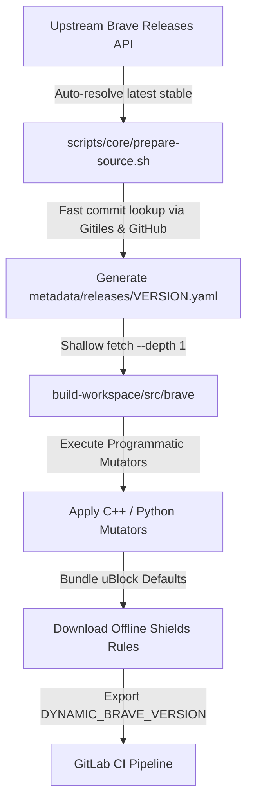
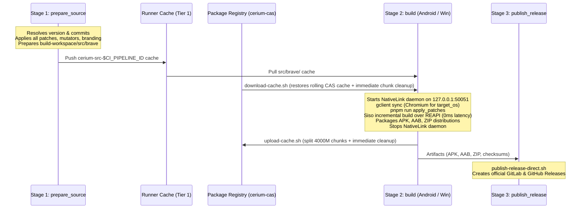

# Cerium Browser: The Complete Engineering & Agent Guide

Welcome to the **Cerium Browser** skill. This guide serves as the definitive reference for autonomous agents and engineers working on the Cerium codebase (downstream distribution of Brave Browser).

---

## 1. Project Vision & Architectural Foundation

### What is Cerium?
**Cerium** (maintained by **Cerium Browser Team**) is an independent downstream distribution of the Brave Browser. It is customized to be:
1. **Completely De-Branded**: Stripped of all Brave Lion branding, proprietary telemetry, and promotional assets; replaced with Cerium's clean identity and `org.cerium.browser` package ID.
2. **Radically Debloated**: Stripped of cryptocurrency wallets, Web3 features, AI chatbots (Leo), VPN background services, BAT rewards, news feeds, and user profiling.
3. **Out-of-the-Box Privacy & Aggressive Shields**: Aggressive ad & tracker blocking enabled by default (`ControlType::BLOCK`), first-party ad blocking enabled by default, and a completely clean New Tab Page (zero background images, sponsored takeovers, top sites, or stats).
4. **Dynamically Built**: Built against upstream Brave and Chromium tags without maintaining a permanent 100 GB hard-forked Git repository.

### Critical Principle: Multi-Platform Vision
While Android (`arm64`, `arm`, `x86_64`) and Windows (`x64`, `arm64`) are currently the active reference targets in GitLab CI/CD, Cerium's architecture is **fundamentally multi-platform**:
- **Supported / Roadmap Platforms**: Android (APK & AAB), Windows (`x64`, `arm64`), Desktop Linux (`x86_64`, `aarch64`), macOS (Apple Silicon `arm64`, Intel `x64`), and iOS.
- **Platform-Agnostic Design Principles**:
  - Release manifests (`metadata/releases/*.yaml`) declare `target_os` and `target_cpu` dynamically.
  - GN build arguments (`args.gn`) debloat features across all platforms (`enable_ai_chat`, `enable_brave_wallet`, `enable_brave_vpn`, `enable_brave_rewards`, `enable_brave_news`, `enable_sparkle`, etc.).
  - Programmatic Python mutators target shared cross-platform C++ subsystems (`components/brave_origin`, `components/brave_shields`, `components/resources`, `components/ntp_background_images`).
  - Modular platform build entry points reside in `scripts/platforms/{android,windows}/` alongside core scripts in `scripts/core/`.

---

## 2. The Ephemeral Upstream & Dynamic Version Flow



### Key Principles:
1. **Zero Permanent Commits in `brave-core`**:
   The `build-workspace/src/brave` and `build-workspace/src` directories are ephemeral build artifacts fetched and constructed at build time. Never make permanent commits in `brave-core`.
2. **Version Independence & Continuous Roll Forward (Always Target Latest Upstream)**:
   Never hardcode versions (e.g. `<version>`) into scripts or CI files. Cerium is engineered to roll forward continuously with upstream Brave and Chromium tags. All mutators, patches, branding assets, and verification workflows must always be tested and maintained to work against the latest stable upstream release tag. When `BRAVE_VERSION` is omitted, `prepare-source.sh` dynamically queries GitHub's `/releases/latest` and Google's Gitiles API to determine the exact pinned commits for both `brave-core` and Chromium.
3. **Lightweight Metadata Generation**:
   `metadata/releases/*.yaml` files are generated dynamically at build time and stored as pipeline artifacts.

---

## 3. Modification Strategy: Hybrid Patching

### The Hybrid Patching Architecture
Modifications to `brave-core` use a **hybrid approach** to balance simplicity with resilience across upstream version bumps:

1. **Git Patches (`patches/`) for standard modifications**:
   - Use standard unified diff (`.patch`) files for straightforward edits like removing XML preference blocks, changing simple C++ constants, or modifying self-contained UI layouts.
   - Example: `patches/android/cerium-branding.patch`.
   - **Important**: Avoid using `.patch` files for highly dynamic code, such as GN build arrays (e.g. `deps = [...]`), which change constantly in upstream Chromium/Brave and will break patch application.

2. **Programmatic Python Mutators (`scripts/`) for complex/dynamic changes**:
   - Use Python scripts (e.g. `apply-features.py`) strictly for modifications that are too brittle for standard patches.
   - Example: Conditionally modifying GN dependency arrays based on debloat flags, or silencing warnings in rapidly changing build scripts.

### Anatomy of an Idempotent Mutator:
```python
def replace_in_file(filepath, search, replacement):
    path = os.path.join(repo_root, filepath)
    if not os.path.exists(path):
        if STRICT:
            print(f"ERROR: MISSING {filepath}", file=sys.stderr)
            sys.exit(1)
        return

    with open(path, "r", encoding="utf-8") as f:
        content = f.read()

    # 1. Idempotency check: never re-apply if already present
    if replacement in content:
        print(f"Skipped {filepath} (already patched)")
        return

    # 2. Semantic replacement
    if search in content:
        content = content.replace(search, replacement, 1)
        with open(path, "w", encoding="utf-8") as f:
            f.write(content)
        print(f"Patched {filepath}")
    else:
        if STRICT:
            print(f"ERROR: Search string not found in {filepath}", file=sys.stderr)
            sys.exit(1)
```

### Standalone Mutator Templates
When a mutator replaces or injects non-trivial source code (>50 lines of C++, Java, or XML), the code is stored in a dedicated template file under a `templates/` subdirectory (e.g. `scripts/mutators/platforms/windows/templates/version_updater_win.cc`) rather than multi-hundred-line Python string literals. This ensures clean syntax highlighting, linting, and effortless maintenance across upstream version bumps.

---

## 4. Architectural Reuse: No Parallel Engines

### Rule: Reuse Existing Brave & Chromium Subsystems
Do not reinvent browser engines. When implementing custom behavior, hook into the existing system's fallback/failure paths rather than constructing a parallel engine.

### Component Updates & Shields Protection
Cerium routes component updates through our secure GitLab Pages static endpoint (`https://ceriumbrowser.gitlab.io/cerium-updater/components`) via `patches/common/custom-updater-endpoint.patch`:
1. **Default Aggressive Blocking**: Cerium defaults to Aggressive ad and tracker blocking out-of-the-box (`ControlType::BLOCK` in `brave_shields_settings_values.h`) and enables `kBraveAdblockDefault1pBlocking` by default via `scripts/mutators/common/shields.py`.
2. **Key Verification**: Enforces publisher key verification (`kCeriumPublisherKeyHash`), batches component checks into a single request, and appends `disable-pings`.
3. **On-Demand Service Initialization**: Initializes `ad_block_service()` on demand with full profile integration to ensure stable browser startup without race conditions.

---

## 5. De-Branding & Debloating

### 1. De-Branding Suite
- Master vector logo lives at `branding/logo.svg`.
- 156 static raster PNG logos across all standard Android densities (`mipmap-mdpi` through `mipmap-xxxhdpi`) and 10 static SVGs reside in `branding/brave-core-static/`.
- `scripts/core/apply-assets.sh` deploys all static assets into `brave-core` resource overlays with zero build-time dynamic rendering (no PIL or rsvg-convert).
- Dedicated vector icons for Cerium Shields reside in `branding/android/shields_drawables/`.
- `scripts/core/apply-branding.py` rebrands GRD/GRDP strings to "Cerium", credits attribution to "Cerium Browser Team", and remaps Grit 63-bit XTB translation fingerprints safely across all locales.
- Desktop ProgIDs (`CeriumHTML`, `CeriumPDF`, `CeriumFile`, `CeriumBFile`, `CeriumDFile`, `CeriumSSFile`) and product names remapped via `scripts/mutators/platforms/windows/branding.py`.

### 2. Radical Debloating & Clean Defaults
Cerium strips all unneeded promotional, cryptocurrency, and auxiliary subsystems:
- **Clean New Tab Page (NTP) Defaults**:
  - Background images and sponsored wallpaper takeovers disabled by default (`kNewTabPageShowBackgroundImage = false`, `kSponsoredEnabled = false`).
  - Top sites tiles & shortcuts disabled by default (`kNtpShortcutsVisible = false`).
  - Cerium / Brave stats counters disabled by default (`kNewTabPageShowStats = false`).
  - Applied cross-platform via `scripts/mutators/common/ntp_ads.py` and on Android via `scripts/mutators/platforms/android/ntp.py`.
- **Android Bottom Navigation Toolbar**:
  - Disabled by default via `scripts/mutators/platforms/android/toolbar.py` (`BottomToolbarConfiguration.java` and `BraveToolbarManager.java`).
- **Windows Services & Installer Debloating**:
  - Neutralized `UpdateBraveVpn` in `install_worker.cc` (preventing registration of Windows NT VPN & WireGuard services).
  - Skipped promo registry reading in `mini_installer.cc`.
- **Enforced via Native Policies**:
  To avoid constant upstream build breakages caused by GN dependency mismatches on Android, Cerium compiles modules cleanly but locks them down unconditionally at runtime:
  - **Native Brave Origin Policy Enforcement**: Bypassing the paywall in `patches/desktop/brave-origin-paywall-bypass.patch` unlocks `IsBraveOriginPurchased() == true`, which natively triggers `LoadBraveOriginPolicies(bundle)` to enforce IPFS, Tor, Playlist, Email Aliases, and Psst lockdown.
  - **Explicit Enterprise Policies (`patches/common/enforce-enterprise-policies.patch`)**: Enforces runtime lockout for `BraveWalletDisabled`, `BraveVPNDisabled`, `BraveAIChatEnabled`, `BraveNewsDisabled`, `BraveRewardsDisabled`, `BraveSearchResultAdsEnabled`, `BraveTalkDisabled`, `BraveStatsPingEnabled`, `BraveWebDiscoveryEnabled`, `BraveP3AEnabled`, `BraveWaybackMachineEnabled`, and `BraveLocalAIEnabled`.
  - Platform Patches: `patches/common/` and `patches/android/` disable promotional flags, unlock backend policy state, remove rating prompts, disable Play in-app updates, and enforce mandatory privacy policies so hidden features cannot be reached or leak data.
- `scripts/core/apply-features.py` isolates Polymer and WebUI resources so Android builds do not transpile unused desktop-only frontend bundles.

---

## 6. Distributed Multi-Platform CI/CD & Two-Tier Caching Architecture

### 1. The 3-Hour SaaS Runner Limit & Pipeline Stages
Chromium + Brave compilation is massive: over 43,000 compilation steps, requiring 1.5 to 3.5 hours on 32-core runners. GitLab CI SaaS runners (`saas-linux-2xlarge-amd64`) enforce a strict job timeout. Running a cold build from checkout to APK or Windows distribution in a single monolithic job risks timing out and losing all compilation progress.

To optimize build speed and streamline orchestration, Cerium uses a high-performance 3-stage multi-platform pipeline:
1. **Stage 1: `prepare_source`**: Lightweight runner. Resolves upstream versions dynamically, fetches exact `brave-core`, executes all patches/mutators/branding, and pushes the **Tier 1 Source Cache** via GitLab CI runner cache.
2. **Stage 2: `build` (`build_android` & `build_windows`)**: Pulls the Tier 1 Source Cache, starts an in-runner NativeLink daemon on `127.0.0.1:50051`, restores the rolling CAS cache from the Package Registry with immediate disk cleanup, compiles incrementally with Siso over REAPI at 0ms latency, packages official distributions (APK/AAB/ZIP), and uploads the updated rolling CAS cache.
3. **Stage 3: `publish` (`publish_release`)**: Collects all multi-platform binary packages and publishes an official GitLab Release with checksums.

---

### 2. The Two-Tier Caching Architecture

| Cache Tier | Storage Layer | Scope & Contents | Key / Identifier | Policy |
|---|---|---|---|---|
| **Tier 1: Source Transport** | GitLab CI Runner Cache | Fully prepared, patched, branded `src/brave/` | `cerium-src-$CI_PIPELINE_ID` | Stage 1: push<br>Stage 2: pull |
| **Tier 2: In-Runner CAS & AC** | GitLab Generic Package Registry | Rolling NativeLink CAS blobs and Action Cache (`/tmp/nativelink/cas` & `ac`) | `latest-${TARGET_ARCH}`<br>(or `latest-win-${TARGET_ARCH}`) | `upload-cache.sh` / `download-cache.sh` |

#### Tier 1: Pre-Patched Source Transport (`src/brave/`) via GitLab CI Runner Cache
- **All `brave-core` modifications MUST happen exclusively in `prepare_source`**:
  - Shallow checkout of exact `brave-core` release commit.
  - Applying all git patches in `patches/` via `apply-patches.sh`.
  - Verifying patch set integrity via `apply-patches.sh --check`.
  - Applying cross-platform GN mutators via `apply-features.py --strict`.
  - Applying Cerium branding overlay and vector assets via `apply-assets.sh`.
  - Applying UI strings remapping via `apply-branding.py --strict`.
  - Prepares `build-workspace/src/brave/` directly in place and caches it via GitLab CI runner cache (`key: cerium-src-$CI_PIPELINE_ID`, `paths: [build-workspace/src/brave/]`, `policy: push`).
- **Runner Cache Transport Configuration**:
  - `prepare_source` caches `build-workspace/src/brave/` directly into GitLab runner cache (`policy: push`).
  - Downstream runners (`build_android`, `build_windows`) pull it via `.build_environment_setup` (`policy: pull`, `key: cerium-src-$CI_PIPELINE_ID`).
  - Platform build scripts (`scripts/platforms/{android,windows}/build.sh`) verify `src/brave` and protect `src/brave` and `src/out` during cleanups via `git clean -ffd -e brave -e out`.
- **CRITICAL RULE FOR AGENTS**: Downstream build runners MUST NEVER re-patch, re-brand, or re-run mutators on `brave-core`. `brave-core` is guaranteed to be completely prepared by Stage 1.

#### Tier 2: In-Runner NativeLink CAS & Action Cache via GitLab Generic Package Registry
- **Why In-Runner NativeLink Local Daemon**:
  - **Local Loopback Speed (0ms latency)**: Siso communicates natively via REAPI (`SISO_REAPI_ADDRESS="127.0.0.1:50051"`, `use_remoteexec = true`, `use_siso = true`, `RBE_service_no_security=true`) with an in-runner NativeLink daemon backed by a local filesystem store (`/tmp/nativelink/cas` and `/tmp/nativelink/ac`).
  - **Immediate Disk Cleanup for 200 GB Runner**: When downloading cache chunks from GitLab Package Registry, `download-cache.sh` extracts them into `/tmp/nativelink` and immediately deletes the downloaded chunk files (`rm -f chunk.tar.gz.*`) so that the runner's 200 GB disk is never exhausted by holding both compressed archives and extracted CAS files simultaneously.
  - **Rolling Package Registry Cache**: Uses GitLab's official Package Registry API:
    `PKG_URL="${CI_API_V4_URL}/projects/${CI_PROJECT_ID}/packages/generic/cerium-cas/${CACHE_VERSION}"`
    where `CACHE_VERSION="latest-${TARGET_ARCH}"` (or `latest-win-${TARGET_ARCH}`).
  - When the build finishes, NativeLink is terminated, the CAS and AC stores are compressed and split into 4000M chunks (`split -b 4000M`), uploaded to update `cerium-cas/${CACHE_VERSION}`, and each chunk is deleted immediately upon upload.
  - If no package exists (e.g. cold builds), `download-cache.sh` logs `Starting cold build` and exits 0 cleanly.

---

### 3. Chromium Source & Build Runners Responsibilities
- Chromium `src` is ephemeral, target-dependent, and heavy (25–30 GB). It is synced on compilation runners via `gclient sync` using target-specific `.gclient` configurations (`target_os = ["android"]` vs `target_os = ["win"]`).
- Downstream build runners (`scripts/platforms/android/build.sh`, `scripts/platforms/windows/build.sh`) ONLY perform Chromium-specific operations after `gclient sync`:
  1. `(cd "${BRAVE_DIR}" && pnpm run apply_patches)`: Applies upstream Brave patches onto Chromium `src`.
  2. `python3 "${REPO_ROOT}/scripts/core/apply-features.py" "${BRAVE_DIR}" --strict --src-dir="${SRC_DIR}" --target-os=...`: Applies Chromium-side mutators (e.g. User-Agent milestone resolution in `components/version_info/` and version display).
- **CRITICAL GUARD**: In `scripts/mutators/context.py`, `has_chromium_src()` verifies that Chromium `src` is populated before allowing any `in_src=True` file mutations. Never run Chromium mutations before `gclient sync`.

---

### 4. Siso & NativeLink Daemon Integration
- Cerium enables Siso (`use_siso = true` and `use_remoteexec = true` in `args.gn`) as its primary build executor.
- Siso connects to NativeLink on `127.0.0.1:50051` via `SISO_REAPI_ADDRESS="127.0.0.1:50051"` and `SISO_REAPI_INSTANCE="main"`.
- NativeLink manages CAS blobs and Action Cache entries in local filesystem storage with an automatic 40 GB eviction policy.
- Local cache outputs and remote execution actions are matched by content digest (Merkle tree), eliminating timestamp-sensitive build graph invalidation across builds.
- Daemon lifecycle is cleanly orchestrated via `scripts/core/nativelink.sh` (`install`, `start`, `stop`, `status`).

---

### 5. Multi-Platform Pipeline Flow



---

### 6. Modular Build Architecture & Component Reuse
- **Shared Orchestration (`scripts/core/build-common.sh`)**: Platform build entry points (`scripts/platforms/{android,windows}/build.sh`) and cache scripts source `build-common.sh` for universal routines:
  - `extract_manifest_val`: Fast YAML manifest property extraction.
  - `ensure_git_compatibility_shim` / `ensure_depot_tools` / `ensure_host_c_compiler` / `ensure_gn_binary`: Toolchain compatibility & hermetic GN bootstrap.
  - `fetch_chromium_git` / `init_clean_chromium_source` / `write_gclient_config` / `sync_and_patch_chromium` / `prepare_brave_branding_and_version`: Chromium checkout, sync, patching, and branding setup.
  - `append_debloated_service_gn_args` / `configure_siso_environment` / `start_build_watchdog` / `stop_build_watchdog` / `run_siso_compilation`: GN debloating, Siso/REAPI config, and checkpointed compilation.
  - `resolve_nativelink_dir` / `shared_upload_cas_cache` / `finalize_ci_cache_upload` / `resolve_gitlab_auth_header` / `resolve_cas_cache_version` / `download_chunks_parallel` / `gitlab_pkg_cleanup_version` / `gitlab_pkg_upload_file`: Cross-container CAS caching & GitLab Generic Package Registry transfers.
  - `archive_build_artifacts`: Unified build log, siso traces, and args.gn packaging.
- **Hermetic Windows Toolchain Manager (`scripts/core/setup-win-toolchain.py`)**:
  - Handles candidate hash resolution (`44f9aa3391`, `436026023a`, upstream `TOOLCHAIN_HASH`), zip integrity testing, registry downloads, xwin layout generation, and SetEnv manifests.
  - Generates `toolchain.env` directly sourced by `build.sh`.
  - Thoroughly tested via dedicated test suite `scripts/tests/test_win_toolchain.py`.
- **Standalone Mutator Templates**:
  - Large C++, Java, or XML implementations injected by mutators (>50 lines) reside in `scripts/mutators/platforms/<platform>/templates/` (e.g. `version_updater_win.cc`), keeping Python mutator logic clean and maintainable.

---

## 7. GitLab CI 4MB Log Limit & Stream Filtering

### The Problem
GitLab CI runner enforces a strict 4 MB (4,194,304 bytes) truncation limit on job console logs. Compiling Chromium produces >20 MB of stdout. Raw streaming causes GitLab to truncate output around step 3,000, hiding subsequent build steps, compiler errors, and failure summaries.

### The Solution: `filter-build-log.py`
In platform build scripts (`scripts/platforms/android/build.sh` and `scripts/platforms/windows/build.sh`), the build stream is piped through `filter-build-log.py`:
```bash
autoninja -C "${OUT_DIR}" ${BUILD_TARGET} 2>&1 | python3 -u "${REPO_ROOT}/scripts/core/filter-build-log.py" "${WORKSPACE_DIR}/build.log"
BUILD_RES=${PIPESTATUS[0]}
```
- **100% Raw Logging**: All lines are written unbuffered to `${WORKSPACE_DIR}/build.log` and uploaded as a CI artifact.
- **Console Throttling**: Standard progress steps (`^\[\s*(\d+)/(\d+)\]`) are throttled to every 50th step plus first and final step (`[50/43210 (0.1%)] ...`).
- **Immediate Error Forwarding**: **100% of non-progress lines** (compiler errors, warnings, tracebacks, notes, linker errors, diagnostic dumps) are passed directly to `stdout` with unbuffered line flushing.
- Reduces console log size from >20 MB to ~150 KB (less than 4% of the limit), completely preventing truncation.
- `after_script` blocks in `.gitlab-ci.yml` dump the tail of `build.log`, `siso_output`, and `siso_failed_commands.sh` in an isolated collapsible section.

---

## 8. Operational Runbooks for Agents

### 1. Mandatory Two-Step Local Verification
Before proposing changes, creating pull requests, or finalizing work:
Agents must ALWAYS perform the two-step verification workflow:

1. **Step 1: Fast Local Master Verification Suite (`verify-all.sh`)**
   ```bash
   ./scripts/core/verify-all.sh
   ```
   Runs 6 master verification steps: manifest validation, mutator syntax & unit tests, CI automation script checks, patch retirement across trees, branding asset limits, and orchestration dry-run.

   Alternatively, run unit tests directly with `pytest`:
   ```bash
   python3 -m pytest scripts/tests/ -v
   ```
   All new programmatic mutators must include dedicated unit tests in `scripts/tests/mutators/test_<name>.py` using pytest fixtures from `conftest.py`.

2. **Step 2: ALWAYS Validate Using `prepare-source.sh`**
   ```bash
   # Dynamically auto-resolves latest upstream stable release (default):
   ./scripts/core/prepare-source.sh

   # Or validate against an explicit target release version:
   ./scripts/core/prepare-source.sh "<version>"
   ```
   Why this is mandatory:
   `verify-all.sh` verifies syntax, unit tests, and dry-run execution, but `prepare-source.sh` executes the complete end-to-end source pipeline against real upstream trees:
   - Queries GitHub / Gitiles APIs to resolve exact commit pins.
   - Shallow-fetches or resets `brave-core` at the exact tag.
   - Applies all unified diff patches in `patches/`.
   - Executes `apply-features.py --strict`.
   - Executes `apply-assets.sh` (branding overlay and vector icons).
   - Executes `apply-branding.py --strict` (GRD/GRDP/XTB string and translation remapping).
   If any patch fails or mutator breaks against real sources, `prepare-source.sh` fails loudly and immediately. Both commands must pass with exit code 0.

### 2. Testing Build Orchestration (Dry-Run / GN-Only)
```bash
# Validate argument parsing and manifest loading:
./scripts/platforms/android/build.sh --manifest="metadata/releases/<version>.yaml" --arch=arm64 --release --dry-run
./scripts/platforms/windows/build.sh --manifest="metadata/releases/<version>.yaml" --arch=x64 --release --dry-run

# Run up to gn gen (verifies args.gn syntax without starting compilation):
./scripts/platforms/android/build.sh --manifest="metadata/releases/<version>.yaml" --arch=arm64 --release --gn-only
./scripts/platforms/windows/build.sh --manifest="metadata/releases/<version>.yaml" --arch=x64 --release --gn-only
```

### 3. Adding a New Debloating Flag
1. Check flag declaration in `brave-core` (search `declare_args()` in `buildflags.gni`).
2. Add flag to `build_arguments` in `prepare-source.sh` release manifest generation.
3. Add flag to `args.gn` template in platform build scripts.
4. Run `./scripts/core/verify-all.sh` to confirm manifest validation passes.

---

## 9. Guardrails & Agent Commandments

1. **Always target and validate the latest upstream release**: Develop, test, and maintain all patches, mutators, and build configs against the latest stable upstream Brave tag. Fix any upstream code shifts or patch conflicts immediately.
2. **NEVER make permanent direct commits in `brave-core` or `chromium`**.
3. **ALWAYS validate using `prepare-source.sh` and `verify-all.sh`**: Every patch, mutator, and branding asset must pass against real upstream sources via `prepare-source.sh` in addition to unit tests in `verify-all.sh`.
4. **Use Hybrid Patching**: `.patch` files for simple edits (XML/constants), Python mutators for dynamic/GN array edits.
5. **NEVER hardcode version numbers** in scripts or CI configs (always use `<version>` placeholders in comments and templates).
6. **NEVER commit secrets** (tokens, keystore passwords, API keys) into the repository.
7. **Always preserve `set -euo pipefail`** in all shell scripts.
8. **Always verify idempotence** on all programmatic mutators.
9. **Always respect user instructions regarding Git operations** (e.g. "dont commit and push" or "commit but do not push").
10. **Branch Model (`release` vs `main`)**:
    - `release` is the production release branch (official signed releases and release tags). By default on push/merge, it compiles all target architectures (`COMPILE_TARGET="all"`) and publishes official releases. When triggered via the GitLab Web UI, it supports interactive `compile_target` selection (`all`, `android`, `windows`, `windows_x64`, `windows_arm64` with default `all`), enabling single-platform releases (e.g. Android only) as well as full multi-platform releases.
    - `main` is for active development, automated testing, and community merges. When triggered manually in the GitLab Web UI, it provides an interactive `compile_target` input dropdown (`all`, `android`, `windows`, `windows_x64`, `windows_arm64` with default `all`) allowing developers to choose target compilation on demand without publishing official releases. All merge requests must target `main`.
11. **Keep modifications strictly minimalist and essential**: Never add speculative checks, defensive clutter, multi-tier fallback globbing, or unnecessary code that wasn't requested. Keep all patches and mutators lean, structured, and focused solely on the required behavior with direct fail-fast error reporting to prevent fragility across upstream version bumps.
12. **Authoritative Packaging Scripts**: `scripts/platforms/{android,windows}/package.sh` is the authoritative multi-platform packaging and signing entry point.
13. **Toolchain Prerequisites**: Windows cross-compilation on Linux runner containers requires `libfuse2` for `ciopfs` to mount the Visual Studio toolchain (`vs_files`), and `GCLIENT_SUPPRESS_GIT_VERSION_WARNING: "1"` set across CI.
14. **Zero Hardcoded Machine Paths**: Never hardcode developer machine paths (such as `/run/media/...` or `/home/...`). Always resolve paths dynamically via environment variables (`LOCAL_BRAVE_CORE_DIR`, `BRAVE_CORE_DIR`, `WORKSPACE_DIR`) with empty or repository-relative defaults.
15. **CI YAML Standards & PyYAML Compatibility**: Do not use non-standard GitLab YAML tags (such as `!reference`) in CI YAML files (`.gitlab-ci.yml`, `.gitlab/ci/*.yml`), because validation suites (`test_ci_automation.py`) parse these files with standard PyYAML `yaml.safe_load_all()`. Use standard YAML templates (`extends`) or shared bash scripts instead.
16. **Multi-Platform Neutral Manifests**: Upstream metadata and release manifests generated by `resolve-versions.py` must remain platform-neutral. Do not hardcode target platform or architecture in `upstream_data["gn_arguments"]["base"]`.
17. **Deduplication & Component Reuse**: Always check `scripts/core/build-common.sh` before writing new build shell routines. Platform scripts in `scripts/platforms/` must focus strictly on platform-specific GN flags and build targets. Centralize toolchain operations in `scripts/core/setup-win-toolchain.py` and separate multi-line C++ or Java mutator code into `templates/` files.
